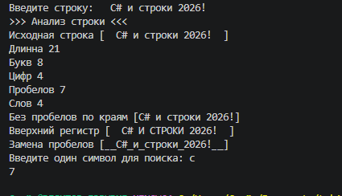

# Практическая работа №19

Автор: Семён Науменко 
Группа: ИСП-251

## Тема

Строки в C#.

## Что реализовано

- определение длины строки;
- подсчёт букв, цифр, пробелов и слов;
- поиск первого индекса символа;
- удаление пробелов по краям;
- перевод в верхний регистр;
- замена пробелов на подчёркивания.

## Короткие ответы

1. Чем отличаются `string` и `char`?

Ответ: string - строка, а char - символ

2. Почему вызов `text.Trim()` без сохранения результата не меняет `text`?

Ответ: Т.к строки в C# не меняемые

3. Зачем при разделении строки используется `RemoveEmptyEntries`?

Ответ: Чтобы программа не считала пробелы как слова

## Результат

